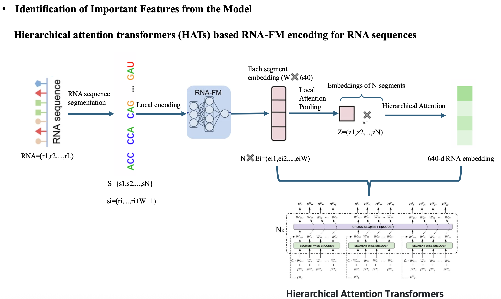

# 基于分层注意力机制的 RNA 序列特征编码与模型预测分析

## 研究目的

本研究旨在进一步探索 RNA 序列中不同区域对模型预测结果的贡献，为后续识别与液–液相分离（Liquid–Liquid Phase Separation, LLPS）相关的关键 RNA 序列区域及潜在功能特征提供基础。

在此前的模型中，RNA 序列首先通过预训练 RNA 语言模型（RNA-FM）提取特征，再使用 **Mean Pooling（平均池化）** 将所有核苷酸的特征向量聚合为固定维度的 RNA 表征。

然而，Mean Pooling 对所有序列位置进行平均聚合，可能弱化局部序列区域的特征差异，尤其对于较长的 RNA 序列，难以进一步分析不同区域对最终预测结果的相对贡献。

## RNA 序列编码策略的改进

为了改善上述局限性，本研究在原有 RNA-FM 编码方法的基础上，引入了 **Hierarchical Attention Transformers（HATs，分层注意力 Transformer）**，根据 RNA 序列长度采用不同的特征编码策略：

- **短 RNA（≤ 1024 nt）**：沿用原有的 RNA-FM 编码方式，通过 Mean Pooling 对核苷酸特征进行聚合，生成固定维度的 RNA 表征。
- **长 RNA（> 1024 nt）**：首先将 RNA 序列划分为多个较短的片段，分别使用 RNA-FM 提取片段特征，再通过 HATs 对不同片段的特征进行整合，并利用注意力池化生成完整 RNA 序列的表征。

与直接对整条 RNA 序列进行平均池化相比，这种分层编码方式能够在片段层面建模不同序列区域之间的关系，为后续分析不同 RNA 区域对模型预测的贡献提供更细粒度的特征基础。

## 模型训练设置

为了重点评估 RNA 语言模型所提取的序列特征及不同编码策略对预测结果的影响，本研究在模型训练阶段**仅使用基于 RNA-FM 的序列特征作为输入，不引入 GraphSAGE 生成的 RNA–蛋白质相互作用图结构特征**。

这一设置旨在减少图结构信息对模型预测的影响，使分析更加集中于 RNA 序列本身的特征表示，并为后续开展 RNA 序列区域的重要性分析提供基础。

## 预期目标

通过结合 RNA-FM 与 HATs，本研究希望在保留 RNA 序列整体特征的同时，引入针对长 RNA 的片段级特征整合机制，以更好地捕捉不同序列区域的特征及其相互关系。

在此基础上，进一步结合**模型可解释性分析（Model Interpretability Analysis）**，通过特征归因、片段遮蔽等方法，识别并评估不同 RNA 序列区域对 LLPS 预测结果的贡献，从而筛选出与模型预测结果密切相关的关键序列区域，为后续探索 LLPS 相关 RNA 的潜在功能序列特征提供依据。

# 数据集

为了评估模型对未见 RNA 数据的**泛化能力与迁移性能（Generalization and Transferability）**，本研究将数据集划分为 **Benchmark 数据集**和 **Unseen 数据集**，分别用于模型训练与独立测试。

- **Benchmark 数据集**：包含 9,484 个 RNA 和 237 个蛋白质样本，用于 GraphSAGE 图神经网络的预训练，以及后续 LLPS 相关 RNA 分类模型的训练与评估。
- **Unseen 数据集**：包含 2,370 个 RNA 和 214 个蛋白质样本，作为独立测试集，用于评估模型对训练阶段未见 RNA 的预测能力。该数据集中的 RNA 不参与任何阶段的模型训练，包括 GraphSAGE 预训练和下游 LLPS 相关 RNA 分类模型的训练。

在数据划分过程中，**Benchmark 与 Unseen 数据集之间不存在重复的 RNA 样本，但允许存在相同的蛋白质样本**。这一设计确保 Unseen 数据集中的 RNA 对模型而言是完全未见的，同时保留部分已知蛋白质的相互作用信息，从而重点考察模型对新 RNA 样本的泛化能力及预测性能。

```shell
GraphSAGE_Transferability/all_data
```

# LLM

用于生成 RNA 和蛋白质预训练语言模型特征嵌入（Embeddings）的相关代码及文件位于以下目录：

```shell
GraphSAGE_Transferability/LLMs_embedding
```

# Reference

1. Liu H., Jian Y., Zeng C., et al. (2025).
   RNA-protein Interaction Prediction Using Network-guided Deep Learning.
   Communications Biology, 8, 247.
   DOI: 10.1038/s42003-025-07694-9
2. Hamilton W. L., Ying R., Leskovec J. (2017).
   Inductive Representation Learning on Large Graphs.
   Proceedings of the 31st International Conference on Neural Information Processing Systems (NeurIPS 2017).
   DOI: 10.48550/arXiv.1706.02216
3. https://github.com/coastalcph/hierarchical-transformers.git
   An Exploration of Hierarchical Attention Transformers for Efficient Long Document Classification
4. Hoang M, Singh M. Locality-aware pooling enhances protein language model performance across varied applications. *Bioinformatics*. 2025;41(1):i217-i226. doi:10.1093/bioinformatics/btaf178